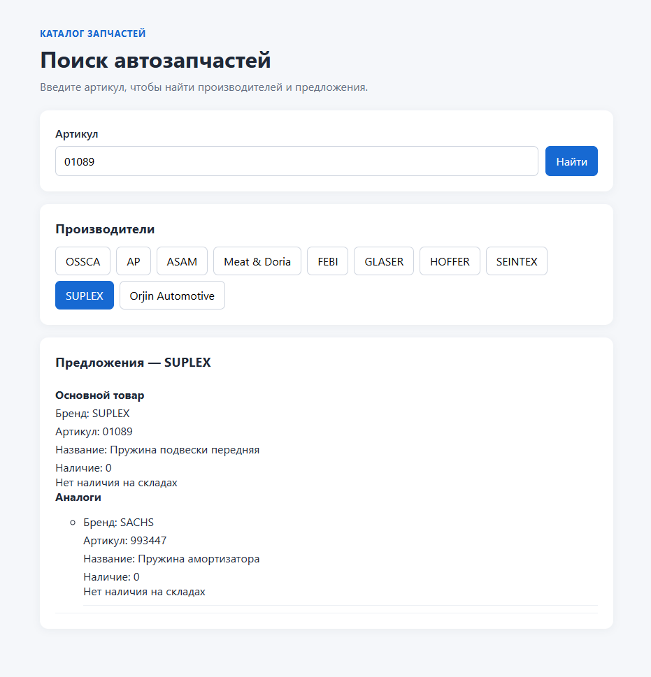

# Тестовое задание для Favorit-parts

React-приложение для поиска автозапчастей по артикулу: показывает производителей, предложения, наличие по складам и аналоги.

Для поиска используется внешний API Favorit-parts.

## Стек

React, JavaScript, Redux Toolkit, React Redux, Vite, CSS.

## Запуск

```bash
npm install
npm run dev
```

## Скриншот


